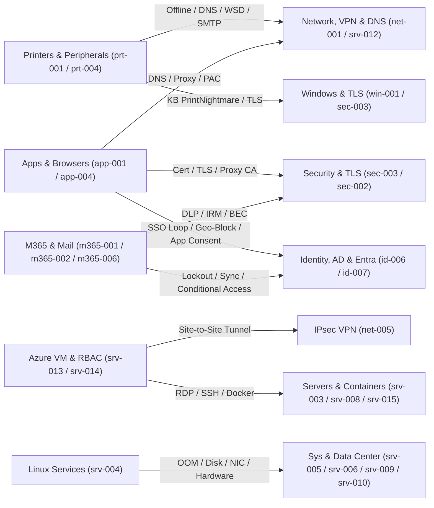

# GuideIT Inter-Subject Troubleshooting Matrix

Master cross-reference across all **85** playbooks organized by **9 Domains** and **23 Sub-Subjects**.

## Cross-Domain Pivot Flowchart

## Complete Domain & Sub-Subject Catalog

### 01_Identity_AD_Entra — Identity / AD & Entra ID (10 playbooks)

| ID | Sub-Subject | Tier | Playbook | Key Escalation & Pivot Targets |
| --- | --- | --- | --- | --- |
| `id-001` | Lockout, MFA & Account Recovery | `L2` | [Account Lockout Investigation](../playbooks/01_Identity_AD_Entra/id-001-account-lockout.md) | [m365-001](../playbooks/02_M365_Email_Collab/m365-001-outlook-auth-loop.md), [sec-001](../playbooks/06_Security_Access/sec-001-bec-token-compromise.md), [id-005](../playbooks/01_Identity_AD_Entra/id-005-windows-domain-trust-relationship-failed.md), [net-004](../playbooks/04_Network_VPN_VoIP/net-004-smb-mapped-drives-missing-and-error-1219.md) |
| `id-002` | Lockout, MFA & Account Recovery | `L2` | [Google Workspace Admin Console 2SV Lockout, Role 403, and Suspended User Recovery](../playbooks/01_Identity_AD_Entra/id-002-google-workspace-admin-2sv-lockout.md) | [m365-004](../playbooks/02_M365_Email_Collab/m365-004-google-workspace-gmail-ndr-and-drive-access.md), [srv-002](../playbooks/08_Servers_Cloud_Infra/srv-002-google-cloud-console-iam-billing-and-quota.md), [id-006](../playbooks/01_Identity_AD_Entra/id-006-entra-app-registration-permissions-and-admin-consent.md) |
| `id-003` | Lockout, MFA & Account Recovery | `L1` | [Entra ID MFA New Phone, Lost Authenticator, and Temporary Access Pass Recovery](../playbooks/01_Identity_AD_Entra/id-003-entra-mfa-new-phone-and-tap-recovery.md) | [id-001](../playbooks/01_Identity_AD_Entra/id-001-account-lockout.md), [sec-001](../playbooks/06_Security_Access/sec-001-bec-token-compromise.md), [mdm-001](../playbooks/07_macOS_Mobile_MDM/mdm-001-intune-compliance-sync.md) |
| `id-004` | Active Directory, GPO & Hybrid Sync | `L3` | [Active Directory GPO Not Applying, SYSVOL Permissions, and DFSR Replication Errors](../playbooks/01_Identity_AD_Entra/id-004-ad-gpo-not-applying-replication-and-dfsr.md) | [srv-012](../playbooks/08_Servers_Cloud_Infra/srv-012-windows-dhcp-exhausted-dns-forwarder-and-ntp-skew.md), [id-005](../playbooks/01_Identity_AD_Entra/id-005-windows-domain-trust-relationship-failed.md), [net-004](../playbooks/04_Network_VPN_VoIP/net-004-smb-mapped-drives-missing-and-error-1219.md), [id-001](../playbooks/01_Identity_AD_Entra/id-001-account-lockout.md) |
| `id-005` | Active Directory, GPO & Hybrid Sync | `L2` | [Windows Domain Trust Relationship Failed (Event ID 5722 / 3210 / 0xC000018B)](../playbooks/01_Identity_AD_Entra/id-005-windows-domain-trust-relationship-failed.md) | [srv-012](../playbooks/08_Servers_Cloud_Infra/srv-012-windows-dhcp-exhausted-dns-forwarder-and-ntp-skew.md), [id-004](../playbooks/01_Identity_AD_Entra/id-004-ad-gpo-not-applying-replication-and-dfsr.md), [id-001](../playbooks/01_Identity_AD_Entra/id-001-account-lockout.md), [win-004](../playbooks/03_Windows_Endpoints/win-004-windows-temporary-profile-recovery.md) |
| `id-006` | Entra Apps & Geo/Conditional Access | `L2` | [Entra ID App Registration Permissions, Admin Consent & Developer Secret Failures](../playbooks/01_Identity_AD_Entra/id-006-entra-app-registration-permissions-and-admin-consent.md) | [srv-014](../playbooks/08_Servers_Cloud_Infra/srv-014-azure-rbac-403-storage-and-keyvault-firewall.md), [app-004](../playbooks/09_Apps_LOB/app-004-dev-git-ssl-proxy-cert-and-powershell-policy.md), [sec-001](../playbooks/06_Security_Access/sec-001-bec-token-compromise.md), [id-002](../playbooks/01_Identity_AD_Entra/id-002-google-workspace-admin-2sv-lockout.md) |
| `id-007` | Entra Apps & Geo/Conditional Access | `L2` | [Geo-Blocking Outside Canada, Conditional Access Named Locations & Travel Access](../playbooks/01_Identity_AD_Entra/id-007-geo-blocking-outside-canada-travel-access.md) | [net-001](../playbooks/04_Network_VPN_VoIP/net-001-dns-apipa-vpn-triage.md), [app-001](../playbooks/09_Apps_LOB/app-001-browser-sso-and-lob-crash.md), [sec-001](../playbooks/06_Security_Access/sec-001-bec-token-compromise.md), [net-005](../playbooks/04_Network_VPN_VoIP/net-005-site-to-site-ipsec-vpn-tunnel-down.md) |
| `id-008` | Active Directory, GPO & Hybrid Sync | `L3` | [Microsoft Entra Connect Sync Errors, Duplicate Attributes & PHS Stalls](../playbooks/01_Identity_AD_Entra/id-008-entra-connect-sync-errors-and-duplicate-attributes.md) | [id-004](../playbooks/01_Identity_AD_Entra/id-004-ad-gpo-not-applying-replication-and-dfsr.md), [m365-006](../playbooks/02_M365_Email_Collab/m365-006-exchange-ndr-550-and-shared-mailbox-missing.md), [id-001](../playbooks/01_Identity_AD_Entra/id-001-account-lockout.md), [m365-001](../playbooks/02_M365_Email_Collab/m365-001-outlook-auth-loop.md) |
| `id-009` | Lockout, MFA & Account Recovery | `L1` | [Password Reset, SSPR Failure, and Cached Windows Credentials Out of Sync](../playbooks/01_Identity_AD_Entra/id-009-password-reset-sspr-and-cached-credentials-sync.md) | [id-001](../playbooks/01_Identity_AD_Entra/id-001-account-lockout.md) |
| `id-010` | Lockout, MFA & Account Recovery | `L1` | [Windows Hello for Business / PIN Not Working and Sign-In Options Missing](../playbooks/01_Identity_AD_Entra/id-010-windows-hello-pin-not-working-and-signin-options.md) | [id-003](../playbooks/01_Identity_AD_Entra/id-003-entra-mfa-new-phone-and-tap-recovery.md) |

### 02_M365_Email_Collab — Microsoft 365 / Email & Collaboration (12 playbooks)

| ID | Sub-Subject | Tier | Playbook | Key Escalation & Pivot Targets |
| --- | --- | --- | --- | --- |
| `m365-001` | Outlook, Exchange & Mail Flow | `L2` | [Outlook Password Prompt Loop and Modern Auth Failure](../playbooks/02_M365_Email_Collab/m365-001-outlook-auth-loop.md) | [id-001](../playbooks/01_Identity_AD_Entra/id-001-account-lockout.md), [net-001](../playbooks/04_Network_VPN_VoIP/net-001-dns-apipa-vpn-triage.md), [sec-003](../playbooks/06_Security_Access/sec-003-tls-ssl-certificate-expired-and-untrusted-ca.md), [app-001](../playbooks/09_Apps_LOB/app-001-browser-sso-and-lob-crash.md), [sec-001](../playbooks/06_Security_Access/sec-001-bec-token-compromise.md) |
| `m365-002` | Docs, OneDrive & Teams Collab | `L1` | [Shared Excel Workbook Cannot Be Modified, Read-Only, or Locked for Editing](../playbooks/02_M365_Email_Collab/m365-002-excel-shared-workbook-locked-readonly.md) | [m365-005](../playbooks/02_M365_Email_Collab/m365-005-onedrive-sync-stuck-and-sharepoint-path-limit.md), [m365-003](../playbooks/02_M365_Email_Collab/m365-003-word-excel-lost-modifications-recovery.md), [net-004](../playbooks/04_Network_VPN_VoIP/net-004-smb-mapped-drives-missing-and-error-1219.md), [sec-004](../playbooks/06_Security_Access/sec-004-purview-dlp-block-and-sensitivity-labels.md) |
| `m365-003` | Docs, OneDrive & Teams Collab | `L1` | [Lost Modifications on a Word or Excel Document Recovery](../playbooks/02_M365_Email_Collab/m365-003-word-excel-lost-modifications-recovery.md) | [m365-005](../playbooks/02_M365_Email_Collab/m365-005-onedrive-sync-stuck-and-sharepoint-path-limit.md), [m365-002](../playbooks/02_M365_Email_Collab/m365-002-excel-shared-workbook-locked-readonly.md), [app-002](../playbooks/09_Apps_LOB/app-002-office-addins-crash-and-pdf-preview-failure.md), [m365-007](../playbooks/02_M365_Email_Collab/m365-007-teams-external-guest-access-and-federation.md) |
| `m365-004` | Outlook, Exchange & Mail Flow | `L2` | [Google Workspace Gmail Delivery Bounce (550 5.7.26) and Shared Drive Access Triage](../playbooks/02_M365_Email_Collab/m365-004-google-workspace-gmail-ndr-and-drive-access.md) | [net-001](../playbooks/04_Network_VPN_VoIP/net-001-dns-apipa-vpn-triage.md), [m365-006](../playbooks/02_M365_Email_Collab/m365-006-exchange-ndr-550-and-shared-mailbox-missing.md), [id-002](../playbooks/01_Identity_AD_Entra/id-002-google-workspace-admin-2sv-lockout.md) |
| `m365-005` | Docs, OneDrive & Teams Collab | `L2` | [OneDrive Sync Stuck Processing Changes and SharePoint Path Limit Errors](../playbooks/02_M365_Email_Collab/m365-005-onedrive-sync-stuck-and-sharepoint-path-limit.md) | [net-001](../playbooks/04_Network_VPN_VoIP/net-001-dns-apipa-vpn-triage.md), [m365-002](../playbooks/02_M365_Email_Collab/m365-002-excel-shared-workbook-locked-readonly.md), [m365-003](../playbooks/02_M365_Email_Collab/m365-003-word-excel-lost-modifications-recovery.md), [mdm-007](../playbooks/07_macOS_Mobile_MDM/mdm-007-macos-finder-smb-share-and-office-licensing.md) |
| `m365-006` | Outlook, Exchange & Mail Flow | `L2` | [Exchange Online NDR Bounces (550 5.7.1 / 5.4.1) and Missing Shared Mailbox Automapping](../playbooks/02_M365_Email_Collab/m365-006-exchange-ndr-550-and-shared-mailbox-missing.md) | [net-001](../playbooks/04_Network_VPN_VoIP/net-001-dns-apipa-vpn-triage.md), [prt-004](../playbooks/05_Printers_Devices/prt-004-scan-to-email-smtp-relay-failure.md), [m365-008](../playbooks/02_M365_Email_Collab/m365-008-exchange-mailbox-full-and-online-archive-stuck.md), [sec-001](../playbooks/06_Security_Access/sec-001-bec-token-compromise.md), [id-008](../playbooks/01_Identity_AD_Entra/id-008-entra-connect-sync-errors-and-duplicate-attributes.md) |
| `m365-007` | Docs, OneDrive & Teams Collab | `L2` | [Microsoft Teams External Federation & B2B Guest Access Blocked](../playbooks/02_M365_Email_Collab/m365-007-teams-external-guest-access-and-federation.md) | [id-007](../playbooks/01_Identity_AD_Entra/id-007-geo-blocking-outside-canada-travel-access.md), [sec-004](../playbooks/06_Security_Access/sec-004-purview-dlp-block-and-sensitivity-labels.md), [m365-005](../playbooks/02_M365_Email_Collab/m365-005-onedrive-sync-stuck-and-sharepoint-path-limit.md), [net-003](../playbooks/04_Network_VPN_VoIP/net-003-teams-voip-choppy-audio-and-jitter.md) |
| `m365-008` | Outlook, Exchange & Mail Flow | `L2` | [Exchange Online Mailbox Full (554 5.2.2) & Online Archive Not Moving Mail](../playbooks/02_M365_Email_Collab/m365-008-exchange-mailbox-full-and-online-archive-stuck.md) | [m365-006](../playbooks/02_M365_Email_Collab/m365-006-exchange-ndr-550-and-shared-mailbox-missing.md), [m365-001](../playbooks/02_M365_Email_Collab/m365-001-outlook-auth-loop.md), [sec-004](../playbooks/06_Security_Access/sec-004-purview-dlp-block-and-sensitivity-labels.md) |
| `m365-009` | Outlook, Exchange & Mail Flow | `L1` | [Outlook Search Not Returning Results, Indexing Broken, or OST File Corrupted](../playbooks/02_M365_Email_Collab/m365-009-outlook-search-not-working-indexing-and-ost-repair.md) | [m365-001](../playbooks/02_M365_Email_Collab/m365-001-outlook-auth-loop.md) |
| `m365-010` | Docs, OneDrive & Teams Collab | `L1` | [Microsoft Teams App Won't Load, Stuck Signing In, or Blank Screen (Cache & Web Fallback)](../playbooks/02_M365_Email_Collab/m365-010-teams-app-wont-load-blank-screen-and-cache-reset.md) | [m365-001](../playbooks/02_M365_Email_Collab/m365-001-outlook-auth-loop.md) |
| `m365-011` | Outlook, Exchange & Mail Flow | `L1` | [Outlook Calendar Sharing, Delegate Permissions, and Meeting Room Booking Errors](../playbooks/02_M365_Email_Collab/m365-011-outlook-calendar-sharing-delegate-and-room-booking.md) | [m365-006](../playbooks/02_M365_Email_Collab/m365-006-exchange-ndr-550-and-shared-mailbox-missing.md) |
| `m365-012` | Docs, OneDrive & Teams Collab | `L1` | [SharePoint and Teams Missing Files, Recycle Bin Restore, and Library Sync Delays](../playbooks/02_M365_Email_Collab/m365-012-sharepoint-teams-files-missing-recycle-bin-and-sync.md) | [m365-005](../playbooks/02_M365_Email_Collab/m365-005-onedrive-sync-stuck-and-sharepoint-path-limit.md) |

### 03_Windows_Endpoints — Windows Endpoints (14 playbooks)

| ID | Sub-Subject | Tier | Playbook | Key Escalation & Pivot Targets |
| --- | --- | --- | --- | --- |
| `win-001` | Updates, Win11 Upgrade & Licensing | `L2` | [Windows Update Failure and Component Store Corruption](../playbooks/03_Windows_Endpoints/win-001-windows-update-corruption.md) | [net-001](../playbooks/04_Network_VPN_VoIP/net-001-dns-apipa-vpn-triage.md), [srv-001](../playbooks/08_Servers_Cloud_Infra/srv-001-vss-backup-and-disk-triage.md), [win-002](../playbooks/03_Windows_Endpoints/win-002-bitlocker-recovery-screen-and-tpm.md), [win-005](../playbooks/03_Windows_Endpoints/win-005-intune-windows-11-migration-and-safeguard-holds.md), [prt-001](../playbooks/05_Printers_Devices/prt-001-spooler-and-0x0000011b.md) |
| `win-002` | BitLocker, BSOD & Performance | `L2` | [BitLocker Recovery Key Prompt After Update and TPM Lockout Triage](../playbooks/03_Windows_Endpoints/win-002-bitlocker-recovery-screen-and-tpm.md) | [mdm-001](../playbooks/07_macOS_Mobile_MDM/mdm-001-intune-compliance-sync.md), [win-001](../playbooks/03_Windows_Endpoints/win-001-windows-update-corruption.md), [win-005](../playbooks/03_Windows_Endpoints/win-005-intune-windows-11-migration-and-safeguard-holds.md) |
| `win-003` | BitLocker, BSOD & Performance | `L3` | [Windows BSOD Crash Dump Analysis, Unexpected Reboot (Event 41), and Driver Triage](../playbooks/03_Windows_Endpoints/win-003-bsod-crash-dump-and-driver-triage.md) | [win-006](../playbooks/03_Windows_Endpoints/win-006-windows-high-cpu-100-disk-and-memory-leak.md), [prt-003](../playbooks/05_Printers_Devices/prt-003-usbc-dock-monitors-not-detected.md), [win-001](../playbooks/03_Windows_Endpoints/win-001-windows-update-corruption.md) |
| `win-004` | User Profiles, Audio & Webcam | `L2` | [Windows Temporary User Profile Recovery (Event ID 1511 / 1515)](../playbooks/03_Windows_Endpoints/win-004-windows-temporary-profile-recovery.md) | [net-004](../playbooks/04_Network_VPN_VoIP/net-004-smb-mapped-drives-missing-and-error-1219.md), [id-005](../playbooks/01_Identity_AD_Entra/id-005-windows-domain-trust-relationship-failed.md), [win-006](../playbooks/03_Windows_Endpoints/win-006-windows-high-cpu-100-disk-and-memory-leak.md) |
| `win-005` | Updates, Win11 Upgrade & Licensing | `L2` | [Intune Windows 10 to Windows 11 Migration, Feature Updates, and Safeguard Holds](../playbooks/03_Windows_Endpoints/win-005-intune-windows-11-migration-and-safeguard-holds.md) | [mdm-008](../playbooks/07_macOS_Mobile_MDM/mdm-008-intune-new-device-enrollment-and-autopilot.md), [win-001](../playbooks/03_Windows_Endpoints/win-001-windows-update-corruption.md), [win-002](../playbooks/03_Windows_Endpoints/win-002-bitlocker-recovery-screen-and-tpm.md), [win-008](../playbooks/03_Windows_Endpoints/win-008-windows-activation-and-licensing-errors.md) |
| `win-006` | BitLocker, BSOD & Performance | `L2` | [Windows High CPU, 100% Disk Usage, and Memory Leak Triage (Event 129 / 153 / 2004)](../playbooks/03_Windows_Endpoints/win-006-windows-high-cpu-100-disk-and-memory-leak.md) | [win-003](../playbooks/03_Windows_Endpoints/win-003-bsod-crash-dump-and-driver-triage.md), [sec-002](../playbooks/06_Security_Access/sec-002-defender-asr-block-and-false-positive.md), [win-001](../playbooks/03_Windows_Endpoints/win-001-windows-update-corruption.md) |
| `win-007` | User Profiles, Audio & Webcam | `L1` | [Windows Webcam, Microphone, and Speaker Audio Not Working (0xA00F4244 / Code 10 / 43)](../playbooks/03_Windows_Endpoints/win-007-windows-audio-webcam-and-mic-not-working.md) | [prt-002](../playbooks/05_Printers_Devices/prt-002-bluetooth-headphones-wont-connect-or-no-audio.md), [prt-003](../playbooks/05_Printers_Devices/prt-003-usbc-dock-monitors-not-detected.md), [net-003](../playbooks/04_Network_VPN_VoIP/net-003-teams-voip-choppy-audio-and-jitter.md) |
| `win-008` | Updates, Win11 Upgrade & Licensing | `L2` | [Windows Activation, KMS/ADBA, and Entra Subscription Licensing Errors](../playbooks/03_Windows_Endpoints/win-008-windows-activation-and-licensing-errors.md) | [srv-012](../playbooks/08_Servers_Cloud_Infra/srv-012-windows-dhcp-exhausted-dns-forwarder-and-ntp-skew.md), [net-001](../playbooks/04_Network_VPN_VoIP/net-001-dns-apipa-vpn-triage.md), [mdm-001](../playbooks/07_macOS_Mobile_MDM/mdm-001-intune-compliance-sync.md), [win-005](../playbooks/03_Windows_Endpoints/win-005-intune-windows-11-migration-and-safeguard-holds.md) |
| `win-009` | User Profiles, Audio & Webcam | `L1` | [Windows Laptop Battery Draining Fast, Not Charging, and Sleep/Wake Failures](../playbooks/03_Windows_Endpoints/win-009-laptop-battery-draining-fast-not-charging-and-sleep-wake.md) | [prt-003](../playbooks/05_Printers_Devices/prt-003-usbc-dock-monitors-not-detected.md) |
| `win-010` | Updates, Win11 Upgrade & Licensing | `L1` | [Windows Slow Startup, Black Screen After Login, and Explorer.exe Freeze](../playbooks/03_Windows_Endpoints/win-010-slow-startup-black-screen-after-login-and-explorer-freeze.md) | [win-006](../playbooks/03_Windows_Endpoints/win-006-windows-high-cpu-100-disk-and-memory-leak.md) |
| `win-011` | BitLocker, BSOD & Performance | `L1` | [Windows Workstation Low Disk Space (C: Drive Full) Safe Cleanup](../playbooks/03_Windows_Endpoints/win-011-windows-low-disk-space-c-drive-full-safe-cleanup.md) | [win-001](../playbooks/03_Windows_Endpoints/win-001-windows-update-corruption.md) |
| `win-012` | BitLocker, BSOD & Performance | `L1` | [Dead PC, Won't Turn On, and No Power Hardware Triage (Desktop & Laptop)](../playbooks/03_Windows_Endpoints/win-012-pc-wont-turn-on-dead-pc-no-power-triage.md) | [win-013](../playbooks/03_Windows_Endpoints/win-013-pc-power-on-black-screen-no-post-display-triage.md), [win-009](../playbooks/03_Windows_Endpoints/win-009-laptop-battery-draining-fast-not-charging-and-sleep-wake.md), [prt-003](../playbooks/05_Printers_Devices/prt-003-usbc-dock-monitors-not-detected.md) |
| `win-013` | BitLocker, BSOD & Performance | `L1` | [PC Turns On With Black Screen, No Display, or Fails POST (Beep / LED Blink Codes)](../playbooks/03_Windows_Endpoints/win-013-pc-power-on-black-screen-no-post-display-triage.md) | [win-010](../playbooks/03_Windows_Endpoints/win-010-slow-startup-black-screen-after-login-and-explorer-freeze.md), [win-012](../playbooks/03_Windows_Endpoints/win-012-pc-wont-turn-on-dead-pc-no-power-triage.md), [win-014](../playbooks/03_Windows_Endpoints/win-014-windows-wont-boot-automatic-repair-loop-and-bcd.md) |
| `win-014` | BitLocker, BSOD & Performance | `L2` | [Windows Won't Boot Up, Automatic Repair Loop, No Bootable Device, and WinRE / BCD Recovery](../playbooks/03_Windows_Endpoints/win-014-windows-wont-boot-automatic-repair-loop-and-bcd.md) | [win-002](../playbooks/03_Windows_Endpoints/win-002-bitlocker-recovery-screen-and-tpm.md), [win-003](../playbooks/03_Windows_Endpoints/win-003-bsod-crash-dump-and-driver-triage.md), [mdm-008](../playbooks/07_macOS_Mobile_MDM/mdm-008-intune-new-device-enrollment-and-autopilot.md) |

### 04_Network_VPN_VoIP — Network, VPN & VoIP (7 playbooks)

| ID | Sub-Subject | Tier | Playbook | Key Escalation & Pivot Targets |
| --- | --- | --- | --- | --- |
| `net-001` | DNS, DHCP, Wi-Fi & VoIP | `L2` | [No Internet, APIPA 169.254.x.x, DNS, and VPN Split-Tunnel Triage](../playbooks/04_Network_VPN_VoIP/net-001-dns-apipa-vpn-triage.md) | [srv-012](../playbooks/08_Servers_Cloud_Infra/srv-012-windows-dhcp-exhausted-dns-forwarder-and-ntp-skew.md), [net-002](../playbooks/04_Network_VPN_VoIP/net-002-wifi-drops-and-8021x-auth.md), [app-001](../playbooks/09_Apps_LOB/app-001-browser-sso-and-lob-crash.md), [prt-001](../playbooks/05_Printers_Devices/prt-001-spooler-and-0x0000011b.md), [net-005](../playbooks/04_Network_VPN_VoIP/net-005-site-to-site-ipsec-vpn-tunnel-down.md), [net-006](../playbooks/04_Network_VPN_VoIP/net-006-client-vpn-wont-connect-forticlient-anyconnect-globalprotect.md) |
| `net-002` | DNS, DHCP, Wi-Fi & VoIP | `L1` | [Wi-Fi Random Disconnects, Connected Without Internet, and 802.1X Auth Triage](../playbooks/04_Network_VPN_VoIP/net-002-wifi-drops-and-8021x-auth.md) | [net-001](../playbooks/04_Network_VPN_VoIP/net-001-dns-apipa-vpn-triage.md), [sec-003](../playbooks/06_Security_Access/sec-003-tls-ssl-certificate-expired-and-untrusted-ca.md), [mdm-001](../playbooks/07_macOS_Mobile_MDM/mdm-001-intune-compliance-sync.md) |
| `net-003` | DNS, DHCP, Wi-Fi & VoIP | `L2` | [Teams and VoIP Choppy Audio, High Jitter, and One-Way Sound Triage](../playbooks/04_Network_VPN_VoIP/net-003-teams-voip-choppy-audio-and-jitter.md) | [net-002](../playbooks/04_Network_VPN_VoIP/net-002-wifi-drops-and-8021x-auth.md), [net-001](../playbooks/04_Network_VPN_VoIP/net-001-dns-apipa-vpn-triage.md), [prt-002](../playbooks/05_Printers_Devices/prt-002-bluetooth-headphones-wont-connect-or-no-audio.md), [win-007](../playbooks/03_Windows_Endpoints/win-007-windows-audio-webcam-and-mic-not-working.md) |
| `net-004` | SMB Drives & IPsec VPN Tunnels | `L2` | [Windows SMB Mapped Network Drives Red X, 0x80070035, and Error 1219](../playbooks/04_Network_VPN_VoIP/net-004-smb-mapped-drives-missing-and-error-1219.md) | [net-001](../playbooks/04_Network_VPN_VoIP/net-001-dns-apipa-vpn-triage.md), [id-001](../playbooks/01_Identity_AD_Entra/id-001-account-lockout.md), [id-004](../playbooks/01_Identity_AD_Entra/id-004-ad-gpo-not-applying-replication-and-dfsr.md), [mdm-007](../playbooks/07_macOS_Mobile_MDM/mdm-007-macos-finder-smb-share-and-office-licensing.md) |
| `net-005` | SMB Drives & IPsec VPN Tunnels | `L3` | [Site-to-Site IPsec VPN Tunnel Down (IKE Phase 1/2 Mismatch & DPD Timeouts)](../playbooks/04_Network_VPN_VoIP/net-005-site-to-site-ipsec-vpn-tunnel-down.md) | [net-006](../playbooks/04_Network_VPN_VoIP/net-006-client-vpn-wont-connect-forticlient-anyconnect-globalprotect.md), [net-001](../playbooks/04_Network_VPN_VoIP/net-001-dns-apipa-vpn-triage.md), [srv-013](../playbooks/08_Servers_Cloud_Infra/srv-013-azure-vm-boot-rdp-ssh-and-serial-console.md), [srv-010](../playbooks/08_Servers_Cloud_Infra/srv-010-datacenter-rack-power-thermal-and-sfp-optics.md) |
| `net-006` | SMB Drives & IPsec VPN Tunnels | `L1` | [Remote Client VPN Cannot Connect (FortiClient, GlobalProtect, AnyConnect, Windows VPN)](../playbooks/04_Network_VPN_VoIP/net-006-client-vpn-wont-connect-forticlient-anyconnect-globalprotect.md) | [net-001](../playbooks/04_Network_VPN_VoIP/net-001-dns-apipa-vpn-triage.md), [net-005](../playbooks/04_Network_VPN_VoIP/net-005-site-to-site-ipsec-vpn-tunnel-down.md) |
| `net-007` | DNS, DHCP, Wi-Fi & VoIP | `L1` | [Office VoIP Desk Phone No Dial Tone, PoE Power Down, or Stuck Registering](../playbooks/04_Network_VPN_VoIP/net-007-voip-desk-phone-no-dial-tone-poe-or-registering.md) | [net-003](../playbooks/04_Network_VPN_VoIP/net-003-teams-voip-choppy-audio-and-jitter.md) |

### 05_Printers_Devices — Printers & Peripherals (5 playbooks)

| ID | Sub-Subject | Tier | Playbook | Key Escalation & Pivot Targets |
| --- | --- | --- | --- | --- |
| `prt-001` | Printers, Spooler & Scan-to-Email | `L1` | [Print Spooler Stuck, Offline Printer, and RPC Print Error 0x0000011b](../playbooks/05_Printers_Devices/prt-001-spooler-and-0x0000011b.md) | [net-001](../playbooks/04_Network_VPN_VoIP/net-001-dns-apipa-vpn-triage.md), [srv-012](../playbooks/08_Servers_Cloud_Infra/srv-012-windows-dhcp-exhausted-dns-forwarder-and-ntp-skew.md), [win-001](../playbooks/03_Windows_Endpoints/win-001-windows-update-corruption.md), [net-004](../playbooks/04_Network_VPN_VoIP/net-004-smb-mapped-drives-missing-and-error-1219.md) |
| `prt-002` | Bluetooth, USB-C Docks & Displays | `L1` | [Bluetooth Headphones Cannot Connect, Drop Audio, or Mic Fails in Calls](../playbooks/05_Printers_Devices/prt-002-bluetooth-headphones-wont-connect-or-no-audio.md) | [win-007](../playbooks/03_Windows_Endpoints/win-007-windows-audio-webcam-and-mic-not-working.md), [net-003](../playbooks/04_Network_VPN_VoIP/net-003-teams-voip-choppy-audio-and-jitter.md), [prt-003](../playbooks/05_Printers_Devices/prt-003-usbc-dock-monitors-not-detected.md) |
| `prt-003` | Bluetooth, USB-C Docks & Displays | `L1` | [USB-C / Thunderbolt Docking Station External Monitors Blank or Flickering](../playbooks/05_Printers_Devices/prt-003-usbc-dock-monitors-not-detected.md) | [win-003](../playbooks/03_Windows_Endpoints/win-003-bsod-crash-dump-and-driver-triage.md), [win-007](../playbooks/03_Windows_Endpoints/win-007-windows-audio-webcam-and-mic-not-working.md), [prt-002](../playbooks/05_Printers_Devices/prt-002-bluetooth-headphones-wont-connect-or-no-audio.md) |
| `prt-004` | Printers, Spooler & Scan-to-Email | `L2` | [Printer Scan-to-Email SMTP Relay Failure (535 5.7.139 / 550 5.7.64)](../playbooks/05_Printers_Devices/prt-004-scan-to-email-smtp-relay-failure.md) | [net-001](../playbooks/04_Network_VPN_VoIP/net-001-dns-apipa-vpn-triage.md), [m365-006](../playbooks/02_M365_Email_Collab/m365-006-exchange-ndr-550-and-shared-mailbox-missing.md), [sec-003](../playbooks/06_Security_Access/sec-003-tls-ssl-certificate-expired-and-untrusted-ca.md), [id-003](../playbooks/01_Identity_AD_Entra/id-003-entra-mfa-new-phone-and-tap-recovery.md) |
| `prt-005` | Bluetooth, USB-C Docks & Displays | `L1` | [USB Keyboard, Mouse, Headset, or External Drive Not Recognized (Power & Driver Triage)](../playbooks/05_Printers_Devices/prt-005-usb-keyboard-mouse-headset-or-drive-not-recognized.md) | [prt-003](../playbooks/05_Printers_Devices/prt-003-usbc-dock-monitors-not-detected.md) |

### 06_Security_Access — Security & Access (6 playbooks)

| ID | Sub-Subject | Tier | Playbook | Key Escalation & Pivot Targets |
| --- | --- | --- | --- | --- |
| `sec-001` | BEC Compromise & Defender ASR | `L3` | [Suspected Business Email Compromise and Session Token Theft](../playbooks/06_Security_Access/sec-001-bec-token-compromise.md) | [id-001](../playbooks/01_Identity_AD_Entra/id-001-account-lockout.md), [m365-006](../playbooks/02_M365_Email_Collab/m365-006-exchange-ndr-550-and-shared-mailbox-missing.md), [id-003](../playbooks/01_Identity_AD_Entra/id-003-entra-mfa-new-phone-and-tap-recovery.md), [id-007](../playbooks/01_Identity_AD_Entra/id-007-geo-blocking-outside-canada-travel-access.md) |
| `sec-002` | BEC Compromise & Defender ASR | `L2` | [Microsoft Defender ASR Rule or Antivirus Blocking Legitimate LOB App or Macro](../playbooks/06_Security_Access/sec-002-defender-asr-block-and-false-positive.md) | [app-002](../playbooks/09_Apps_LOB/app-002-office-addins-crash-and-pdf-preview-failure.md), [win-006](../playbooks/03_Windows_Endpoints/win-006-windows-high-cpu-100-disk-and-memory-leak.md), [sec-001](../playbooks/06_Security_Access/sec-001-bec-token-compromise.md) |
| `sec-003` | TLS/SSL Certs, Purview DLP & Labels | `L2` | [TLS/SSL Certificate Expired, Missing Intermediate Chain, and Untrusted Root CA](../playbooks/06_Security_Access/sec-003-tls-ssl-certificate-expired-and-untrusted-ca.md) | [app-001](../playbooks/09_Apps_LOB/app-001-browser-sso-and-lob-crash.md), [app-004](../playbooks/09_Apps_LOB/app-004-dev-git-ssl-proxy-cert-and-powershell-policy.md), [net-002](../playbooks/04_Network_VPN_VoIP/net-002-wifi-drops-and-8021x-auth.md), [m365-001](../playbooks/02_M365_Email_Collab/m365-001-outlook-auth-loop.md) |
| `sec-004` | TLS/SSL Certs, Purview DLP & Labels | `L2` | [Microsoft Purview DLP Policy Blocks & Sensitivity Label Encryption Denied](../playbooks/06_Security_Access/sec-004-purview-dlp-block-and-sensitivity-labels.md) | [m365-002](../playbooks/02_M365_Email_Collab/m365-002-excel-shared-workbook-locked-readonly.md), [m365-007](../playbooks/02_M365_Email_Collab/m365-007-teams-external-guest-access-and-federation.md), [m365-008](../playbooks/02_M365_Email_Collab/m365-008-exchange-mailbox-full-and-online-archive-stuck.md), [sec-001](../playbooks/06_Security_Access/sec-001-bec-token-compromise.md) |
| `sec-005` | BEC Compromise & Defender ASR | `L1` | [User Cannot Install Approved Software, UAC Admin Prompt, and Local Admin Audit](../playbooks/06_Security_Access/sec-005-software-install-uac-admin-prompt-and-local-admin-audit.md) | [sec-002](../playbooks/06_Security_Access/sec-002-defender-asr-block-and-false-positive.md) |
| `sec-006` | BEC Compromise & Defender ASR | `L1` | [Windows Defender Firewall Blocking App, Inbound Port, or Listening Port Conflict](../playbooks/06_Security_Access/sec-006-windows-firewall-blocked-app-and-listening-port-conflict.md) | [srv-003](../playbooks/08_Servers_Cloud_Infra/srv-003-rdp-credssp-and-nla-connection-failed.md), [srv-016](../playbooks/08_Servers_Cloud_Infra/srv-016-sql-server-login-18456-log-full-9002-and-blocking.md), [net-001](../playbooks/04_Network_VPN_VoIP/net-001-dns-apipa-vpn-triage.md) |

### 07_macOS_Mobile_MDM — macOS, Mobile & MDM (9 playbooks)

| ID | Sub-Subject | Tier | Playbook | Key Escalation & Pivot Targets |
| --- | --- | --- | --- | --- |
| `mdm-001` | Intune Enrollment, Autopilot & Compliance | `L2` | [macOS and iOS Intune MDM Sync and Conditional Access Compliance Failure](../playbooks/07_macOS_Mobile_MDM/mdm-001-intune-compliance-sync.md) | [mdm-008](../playbooks/07_macOS_Mobile_MDM/mdm-008-intune-new-device-enrollment-and-autopilot.md), [m365-001](../playbooks/02_M365_Email_Collab/m365-001-outlook-auth-loop.md), [win-002](../playbooks/03_Windows_Endpoints/win-002-bitlocker-recovery-screen-and-tpm.md), [net-002](../playbooks/04_Network_VPN_VoIP/net-002-wifi-drops-and-8021x-auth.md) |
| `mdm-002` | macOS Basics, Gatekeeper, Keychain & SMB | `L2` | [macOS Login Keychain Password Loop and Platform SSO / FileVault Desync](../playbooks/07_macOS_Mobile_MDM/mdm-002-macos-keychain-loop-and-platform-sso.md) | [id-001](../playbooks/01_Identity_AD_Entra/id-001-account-lockout.md), [mdm-001](../playbooks/07_macOS_Mobile_MDM/mdm-001-intune-compliance-sync.md), [mdm-007](../playbooks/07_macOS_Mobile_MDM/mdm-007-macos-finder-smb-share-and-office-licensing.md) |
| `mdm-003` | macOS Basics, Gatekeeper, Keychain & SMB | `L1` | [Beginner macOS Troubleshooting Guide — Navigation, Force Quit, and Slow Mac](../playbooks/07_macOS_Mobile_MDM/mdm-003-macos-beginner-navigation-force-quit-and-slow-mac.md) | [mdm-005](../playbooks/07_macOS_Mobile_MDM/mdm-005-macos-startup-disk-full-and-apfs-snapshots.md), [mdm-004](../playbooks/07_macOS_Mobile_MDM/mdm-004-macos-gatekeeper-app-blocked-and-privacy-permissions.md), [mdm-006](../playbooks/07_macOS_Mobile_MDM/mdm-006-macos-recovery-mode-boot-failure-and-first-aid.md) |
| `mdm-004` | macOS Basics, Gatekeeper, Keychain & SMB | `L1` | [Beginner macOS Gatekeeper App Blocked and Privacy (TCC) Permissions Guide](../playbooks/07_macOS_Mobile_MDM/mdm-004-macos-gatekeeper-app-blocked-and-privacy-permissions.md) | [mdm-001](../playbooks/07_macOS_Mobile_MDM/mdm-001-intune-compliance-sync.md), [mdm-003](../playbooks/07_macOS_Mobile_MDM/mdm-003-macos-beginner-navigation-force-quit-and-slow-mac.md), [sec-002](../playbooks/06_Security_Access/sec-002-defender-asr-block-and-false-positive.md) |
| `mdm-005` | macOS Disk Full & Recovery Mode | `L2` | [Beginner macOS Startup Disk Full, System Data Bloat, and APFS Snapshots](../playbooks/07_macOS_Mobile_MDM/mdm-005-macos-startup-disk-full-and-apfs-snapshots.md) | [m365-005](../playbooks/02_M365_Email_Collab/m365-005-onedrive-sync-stuck-and-sharepoint-path-limit.md), [mdm-003](../playbooks/07_macOS_Mobile_MDM/mdm-003-macos-beginner-navigation-force-quit-and-slow-mac.md), [mdm-006](../playbooks/07_macOS_Mobile_MDM/mdm-006-macos-recovery-mode-boot-failure-and-first-aid.md) |
| `mdm-006` | macOS Disk Full & Recovery Mode | `L2` | [Beginner macOS Recovery Mode, Boot Failure, and Disk Utility First Aid Guide](../playbooks/07_macOS_Mobile_MDM/mdm-006-macos-recovery-mode-boot-failure-and-first-aid.md) | [mdm-005](../playbooks/07_macOS_Mobile_MDM/mdm-005-macos-startup-disk-full-and-apfs-snapshots.md), [mdm-002](../playbooks/07_macOS_Mobile_MDM/mdm-002-macos-keychain-loop-and-platform-sso.md), [mdm-003](../playbooks/07_macOS_Mobile_MDM/mdm-003-macos-beginner-navigation-force-quit-and-slow-mac.md) |
| `mdm-007` | macOS Basics, Gatekeeper, Keychain & SMB | `L1` | [Beginner macOS Finder SMB Network Share, DNS Flush, and Office Mac Licensing](../playbooks/07_macOS_Mobile_MDM/mdm-007-macos-finder-smb-share-and-office-licensing.md) | [net-004](../playbooks/04_Network_VPN_VoIP/net-004-smb-mapped-drives-missing-and-error-1219.md), [net-001](../playbooks/04_Network_VPN_VoIP/net-001-dns-apipa-vpn-triage.md), [mdm-002](../playbooks/07_macOS_Mobile_MDM/mdm-002-macos-keychain-loop-and-platform-sso.md), [app-003](../playbooks/09_Apps_LOB/app-003-adobe-acrobat-creative-cloud-licensing-and-repair.md) |
| `mdm-008` | Intune Enrollment, Autopilot & Compliance | `L2` | [Intune New Device Enrollment, Windows Autopilot OOBE, and ESP Failures](../playbooks/07_macOS_Mobile_MDM/mdm-008-intune-new-device-enrollment-and-autopilot.md) | [mdm-001](../playbooks/07_macOS_Mobile_MDM/mdm-001-intune-compliance-sync.md), [win-005](../playbooks/03_Windows_Endpoints/win-005-intune-windows-11-migration-and-safeguard-holds.md), [net-001](../playbooks/04_Network_VPN_VoIP/net-001-dns-apipa-vpn-triage.md), [id-004](../playbooks/01_Identity_AD_Entra/id-004-ad-gpo-not-applying-replication-and-dfsr.md) |
| `mdm-009` | Intune Enrollment, Autopilot & Compliance | `L1` | [Mobile (iPhone / Android) Outlook & Teams App Not Syncing or Blocked by App Protection](../playbooks/07_macOS_Mobile_MDM/mdm-009-mobile-outlook-teams-not-syncing-and-app-protection.md) | [mdm-001](../playbooks/07_macOS_Mobile_MDM/mdm-001-intune-compliance-sync.md) |

### 08_Servers_Cloud_Infra — Servers, Cloud & Infrastructure (17 playbooks)

| ID | Sub-Subject | Tier | Playbook | Key Escalation & Pivot Targets |
| --- | --- | --- | --- | --- |
| `srv-001` | Windows Server, RDP, DHCP/DNS & SQL | `L3` | [Windows Server Disk Space Exhaustion and VSS Shadow Copy Backup Failure](../playbooks/08_Servers_Cloud_Infra/srv-001-vss-backup-and-disk-triage.md) | [win-001](../playbooks/03_Windows_Endpoints/win-001-windows-update-corruption.md), [srv-016](../playbooks/08_Servers_Cloud_Infra/srv-016-sql-server-login-18456-log-full-9002-and-blocking.md), [srv-013](../playbooks/08_Servers_Cloud_Infra/srv-013-azure-vm-boot-rdp-ssh-and-serial-console.md) |
| `srv-002` | Azure, Google Cloud & Containers | `L3` | [Google Cloud Console IAM 403, Org Policy, Billing Suspension, and Quota Triage](../playbooks/08_Servers_Cloud_Infra/srv-002-google-cloud-console-iam-billing-and-quota.md) | [id-002](../playbooks/01_Identity_AD_Entra/id-002-google-workspace-admin-2sv-lockout.md), [m365-004](../playbooks/02_M365_Email_Collab/m365-004-google-workspace-gmail-ndr-and-drive-access.md), [srv-014](../playbooks/08_Servers_Cloud_Infra/srv-014-azure-rbac-403-storage-and-keyvault-firewall.md) |
| `srv-003` | Windows Server, RDP, DHCP/DNS & SQL | `L2` | [Remote Desktop (RDP) Refused, CredSSP Encryption Oracle, and NLA Failure](../playbooks/08_Servers_Cloud_Infra/srv-003-rdp-credssp-and-nla-connection-failed.md) | [win-001](../playbooks/03_Windows_Endpoints/win-001-windows-update-corruption.md), [net-001](../playbooks/04_Network_VPN_VoIP/net-001-dns-apipa-vpn-triage.md), [id-001](../playbooks/01_Identity_AD_Entra/id-001-account-lockout.md), [srv-013](../playbooks/08_Servers_Cloud_Infra/srv-013-azure-vm-boot-rdp-ssh-and-serial-console.md) |
| `srv-004` | Linux Services, CPU/Disk, Network & SSH | `L2` | [Linux systemd Service Crash, Exit Codes, and journalctl Diagnostics](../playbooks/08_Servers_Cloud_Infra/srv-004-linux-systemd-service-crash-and-journalctl.md) | [srv-005](../playbooks/08_Servers_Cloud_Infra/srv-005-linux-high-cpu-oom-killer-and-io-wait.md), [srv-006](../playbooks/08_Servers_Cloud_Infra/srv-006-linux-disk-full-inodes-lsof-and-readonly-fs.md), [srv-007](../playbooks/08_Servers_Cloud_Infra/srv-007-linux-network-nic-bonding-and-firewall.md), [srv-015](../playbooks/08_Servers_Cloud_Infra/srv-015-docker-container-crashloop-and-overlay-disk.md) |
| `srv-005` | Linux Services, CPU/Disk, Network & SSH | `L3` | [Linux High CPU, Memory Pressure, OOM Killer, and I/O Wait Triage](../playbooks/08_Servers_Cloud_Infra/srv-005-linux-high-cpu-oom-killer-and-io-wait.md) | [srv-004](../playbooks/08_Servers_Cloud_Infra/srv-004-linux-systemd-service-crash-and-journalctl.md), [srv-006](../playbooks/08_Servers_Cloud_Infra/srv-006-linux-disk-full-inodes-lsof-and-readonly-fs.md), [srv-009](../playbooks/08_Servers_Cloud_Infra/srv-009-datacenter-ipmi-raid-smart-and-ecc-hardware.md) |
| `srv-006` | Linux Services, CPU/Disk, Network & SSH | `L2` | [Linux Disk Full (ENOSPC), Inode Exhaustion, Deleted Open Files, and Read-Only FS](../playbooks/08_Servers_Cloud_Infra/srv-006-linux-disk-full-inodes-lsof-and-readonly-fs.md) | [srv-015](../playbooks/08_Servers_Cloud_Infra/srv-015-docker-container-crashloop-and-overlay-disk.md), [srv-005](../playbooks/08_Servers_Cloud_Infra/srv-005-linux-high-cpu-oom-killer-and-io-wait.md), [srv-009](../playbooks/08_Servers_Cloud_Infra/srv-009-datacenter-ipmi-raid-smart-and-ecc-hardware.md), [srv-011](../playbooks/08_Servers_Cloud_Infra/srv-011-linux-boot-failure-grub-and-fstab-emergency.md) |
| `srv-007` | Linux Services, CPU/Disk, Network & SSH | `L2` | [Linux Network Interfaces, LACP Bonding, DNS, and Firewall (nftables/ufw/firewalld)](../playbooks/08_Servers_Cloud_Infra/srv-007-linux-network-nic-bonding-and-firewall.md) | [net-001](../playbooks/04_Network_VPN_VoIP/net-001-dns-apipa-vpn-triage.md), [srv-010](../playbooks/08_Servers_Cloud_Infra/srv-010-datacenter-rack-power-thermal-and-sfp-optics.md), [srv-008](../playbooks/08_Servers_Cloud_Infra/srv-008-linux-ssh-permission-denied-and-pam-lockout.md), [srv-004](../playbooks/08_Servers_Cloud_Infra/srv-004-linux-systemd-service-crash-and-journalctl.md) |
| `srv-008` | Linux Services, CPU/Disk, Network & SSH | `L2` | [Linux SSH Permission Denied, Key Auth, Host Key Mismatch, and PAM Lockout](../playbooks/08_Servers_Cloud_Infra/srv-008-linux-ssh-permission-denied-and-pam-lockout.md) | [srv-007](../playbooks/08_Servers_Cloud_Infra/srv-007-linux-network-nic-bonding-and-firewall.md), [srv-004](../playbooks/08_Servers_Cloud_Infra/srv-004-linux-systemd-service-crash-and-journalctl.md), [srv-013](../playbooks/08_Servers_Cloud_Infra/srv-013-azure-vm-boot-rdp-ssh-and-serial-console.md), [id-001](../playbooks/01_Identity_AD_Entra/id-001-account-lockout.md) |
| `srv-009` | Data Center IPMI/RAID, Fiber & Boot | `L3` | [Data Center IPMI/iDRAC/iLO, RAID Degraded, SMART Disk, and ECC/MCE Hardware Triage](../playbooks/08_Servers_Cloud_Infra/srv-009-datacenter-ipmi-raid-smart-and-ecc-hardware.md) | [srv-010](../playbooks/08_Servers_Cloud_Infra/srv-010-datacenter-rack-power-thermal-and-sfp-optics.md), [srv-006](../playbooks/08_Servers_Cloud_Infra/srv-006-linux-disk-full-inodes-lsof-and-readonly-fs.md), [srv-011](../playbooks/08_Servers_Cloud_Infra/srv-011-linux-boot-failure-grub-and-fstab-emergency.md), [srv-005](../playbooks/08_Servers_Cloud_Infra/srv-005-linux-high-cpu-oom-killer-and-io-wait.md) |
| `srv-010` | Data Center IPMI/RAID, Fiber & Boot | `L2` | [Data Center Rack Power (A/B PSU), Thermal Trips, and SFP+/Fiber Optical Diagnostics](../playbooks/08_Servers_Cloud_Infra/srv-010-datacenter-rack-power-thermal-and-sfp-optics.md) | [srv-009](../playbooks/08_Servers_Cloud_Infra/srv-009-datacenter-ipmi-raid-smart-and-ecc-hardware.md), [srv-007](../playbooks/08_Servers_Cloud_Infra/srv-007-linux-network-nic-bonding-and-firewall.md), [net-005](../playbooks/04_Network_VPN_VoIP/net-005-site-to-site-ipsec-vpn-tunnel-down.md) |
| `srv-011` | Data Center IPMI/RAID, Fiber & Boot | `L3` | [Linux Boot Failure, Broken /etc/fstab Emergency Mode, GRUB Rescue, and initramfs](../playbooks/08_Servers_Cloud_Infra/srv-011-linux-boot-failure-grub-and-fstab-emergency.md) | [srv-006](../playbooks/08_Servers_Cloud_Infra/srv-006-linux-disk-full-inodes-lsof-and-readonly-fs.md), [srv-009](../playbooks/08_Servers_Cloud_Infra/srv-009-datacenter-ipmi-raid-smart-and-ecc-hardware.md), [srv-013](../playbooks/08_Servers_Cloud_Infra/srv-013-azure-vm-boot-rdp-ssh-and-serial-console.md) |
| `srv-012` | Windows Server, RDP, DHCP/DNS & SQL | `L3` | [Windows Server DHCP Scope Exhausted, DNS AD Load Failure, and Kerberos Time Skew](../playbooks/08_Servers_Cloud_Infra/srv-012-windows-dhcp-exhausted-dns-forwarder-and-ntp-skew.md) | [net-001](../playbooks/04_Network_VPN_VoIP/net-001-dns-apipa-vpn-triage.md), [id-004](../playbooks/01_Identity_AD_Entra/id-004-ad-gpo-not-applying-replication-and-dfsr.md), [id-005](../playbooks/01_Identity_AD_Entra/id-005-windows-domain-trust-relationship-failed.md), [prt-001](../playbooks/05_Printers_Devices/prt-001-spooler-and-0x0000011b.md) |
| `srv-013` | Azure, Google Cloud & Containers | `L3` | [Azure VM Boot Failures, RDP/SSH Unreachable, NSG & Serial Console Triage](../playbooks/08_Servers_Cloud_Infra/srv-013-azure-vm-boot-rdp-ssh-and-serial-console.md) | [srv-014](../playbooks/08_Servers_Cloud_Infra/srv-014-azure-rbac-403-storage-and-keyvault-firewall.md), [srv-003](../playbooks/08_Servers_Cloud_Infra/srv-003-rdp-credssp-and-nla-connection-failed.md), [srv-008](../playbooks/08_Servers_Cloud_Infra/srv-008-linux-ssh-permission-denied-and-pam-lockout.md), [net-005](../playbooks/04_Network_VPN_VoIP/net-005-site-to-site-ipsec-vpn-tunnel-down.md), [srv-001](../playbooks/08_Servers_Cloud_Infra/srv-001-vss-backup-and-disk-triage.md) |
| `srv-014` | Azure, Google Cloud & Containers | `L2` | [Azure RBAC 403 Errors, Storage Permission Mismatch & Key Vault Firewall Blocks](../playbooks/08_Servers_Cloud_Infra/srv-014-azure-rbac-403-storage-and-keyvault-firewall.md) | [srv-013](../playbooks/08_Servers_Cloud_Infra/srv-013-azure-vm-boot-rdp-ssh-and-serial-console.md), [id-006](../playbooks/01_Identity_AD_Entra/id-006-entra-app-registration-permissions-and-admin-consent.md), [srv-002](../playbooks/08_Servers_Cloud_Infra/srv-002-google-cloud-console-iam-billing-and-quota.md) |
| `srv-015` | Azure, Google Cloud & Containers | `L2` | [Docker Container CrashLoopBackOff, Port Conflicts (EADDRINUSE) & Overlay2 Disk Full](../playbooks/08_Servers_Cloud_Infra/srv-015-docker-container-crashloop-and-overlay-disk.md) | [srv-006](../playbooks/08_Servers_Cloud_Infra/srv-006-linux-disk-full-inodes-lsof-and-readonly-fs.md), [srv-004](../playbooks/08_Servers_Cloud_Infra/srv-004-linux-systemd-service-crash-and-journalctl.md), [srv-007](../playbooks/08_Servers_Cloud_Infra/srv-007-linux-network-nic-bonding-and-firewall.md), [app-004](../playbooks/09_Apps_LOB/app-004-dev-git-ssl-proxy-cert-and-powershell-policy.md) |
| `srv-016` | Windows Server, RDP, DHCP/DNS & SQL | `L3` | [SQL Server Login Failed (18456), Transaction Log Full (9002) & Deadlocks](../playbooks/08_Servers_Cloud_Infra/srv-016-sql-server-login-18456-log-full-9002-and-blocking.md) | [srv-001](../playbooks/08_Servers_Cloud_Infra/srv-001-vss-backup-and-disk-triage.md), [app-002](../playbooks/09_Apps_LOB/app-002-office-addins-crash-and-pdf-preview-failure.md), [id-005](../playbooks/01_Identity_AD_Entra/id-005-windows-domain-trust-relationship-failed.md), [id-001](../playbooks/01_Identity_AD_Entra/id-001-account-lockout.md) |
| `srv-017` | Windows Server, RDP, DHCP/DNS & SQL | `L2` | [Windows File Server Shared Folder Access Denied (NTFS vs Share Permissions & File Locks)](../playbooks/08_Servers_Cloud_Infra/srv-017-windows-file-server-shared-folder-access-denied-and-locks.md) | [net-004](../playbooks/04_Network_VPN_VoIP/net-004-smb-mapped-drives-missing-and-error-1219.md) |

### 09_Apps_LOB — Applications & LOB (5 playbooks)

| ID | Sub-Subject | Tier | Playbook | Key Escalation & Pivot Targets |
| --- | --- | --- | --- | --- |
| `app-001` | Browsers, LOB SSO & Dev Tooling | `L1` | [Browser SSO Redirect Loop, Profile Conflict, and LOB App Crash Triage](../playbooks/09_Apps_LOB/app-001-browser-sso-and-lob-crash.md) | [net-001](../playbooks/04_Network_VPN_VoIP/net-001-dns-apipa-vpn-triage.md), [sec-003](../playbooks/06_Security_Access/sec-003-tls-ssl-certificate-expired-and-untrusted-ca.md), [m365-001](../playbooks/02_M365_Email_Collab/m365-001-outlook-auth-loop.md), [id-007](../playbooks/01_Identity_AD_Entra/id-007-geo-blocking-outside-canada-travel-access.md) |
| `app-002` | Office Add-ins, PDF & Adobe Licensing | `L1` | [Excel/Word Freezing on Open, COM Add-in Conflict, and PDF Previewer Failure](../playbooks/09_Apps_LOB/app-002-office-addins-crash-and-pdf-preview-failure.md) | [m365-003](../playbooks/02_M365_Email_Collab/m365-003-word-excel-lost-modifications-recovery.md), [sec-002](../playbooks/06_Security_Access/sec-002-defender-asr-block-and-false-positive.md), [app-003](../playbooks/09_Apps_LOB/app-003-adobe-acrobat-creative-cloud-licensing-and-repair.md), [srv-016](../playbooks/08_Servers_Cloud_Infra/srv-016-sql-server-login-18456-log-full-9002-and-blocking.md) |
| `app-003` | Office Add-ins, PDF & Adobe Licensing | `L1` | [Adobe Acrobat and Creative Cloud Licensing Errors, Sign-In Loops, and Repair](../playbooks/09_Apps_LOB/app-003-adobe-acrobat-creative-cloud-licensing-and-repair.md) | [app-002](../playbooks/09_Apps_LOB/app-002-office-addins-crash-and-pdf-preview-failure.md), [sec-003](../playbooks/06_Security_Access/sec-003-tls-ssl-certificate-expired-and-untrusted-ca.md), [mdm-007](../playbooks/07_macOS_Mobile_MDM/mdm-007-macos-finder-smb-share-and-office-licensing.md), [app-001](../playbooks/09_Apps_LOB/app-001-browser-sso-and-lob-crash.md) |
| `app-004` | Browsers, LOB SSO & Dev Tooling | `L2` | [Developer Git/NPM/PIP SSL Proxy Certificate Errors & PowerShell ExecutionPolicy](../playbooks/09_Apps_LOB/app-004-dev-git-ssl-proxy-cert-and-powershell-policy.md) | [sec-003](../playbooks/06_Security_Access/sec-003-tls-ssl-certificate-expired-and-untrusted-ca.md), [id-004](../playbooks/01_Identity_AD_Entra/id-004-ad-gpo-not-applying-replication-and-dfsr.md), [id-006](../playbooks/01_Identity_AD_Entra/id-006-entra-app-registration-permissions-and-admin-consent.md), [srv-015](../playbooks/08_Servers_Cloud_Infra/srv-015-docker-container-crashloop-and-overlay-disk.md) |
| `app-005` | Browsers, LOB SSO & Dev Tooling | `L1` | [Web Browser Slow, Popups/Adware Extensions, Clear Cache, and Default PDF/Mail Handler Reset](../playbooks/09_Apps_LOB/app-005-browser-slow-popups-cache-and-default-app-associations.md) | [app-001](../playbooks/09_Apps_LOB/app-001-browser-sso-and-lob-crash.md) |
